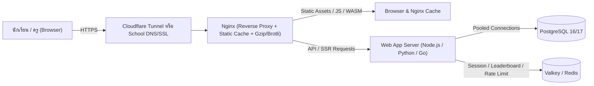
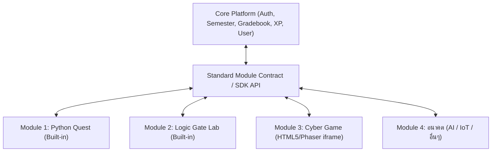
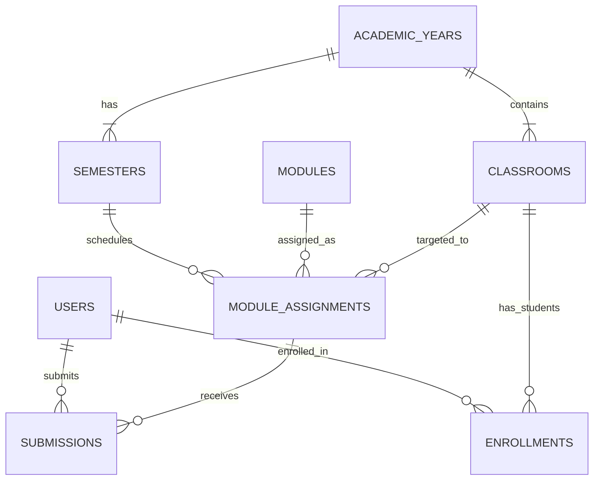

# แผนการพัฒนาเว็บไซต์แหล่งเรียนรู้คอมพิวเตอร์และเทคโนโลยี (ระดับชั้น ม.1 – ม.3)

เอกสารฉบับนี้สรุปแนวทางการออกแบบสถาปัตยกรรม การเลือกเทคโนโลยี ระบบฐานข้อมูล ความปลอดภัย และแผนการดำเนินงาน เพื่อใช้ประกอบการตัดสินใจก่อนเริ่มพัฒนาจริง

---

## สรุปภาพรวมและข้อกำหนดระบบ

| หัวข้อ | รายละเอียด / ข้อจำกัดปัจจุบัน |
| :--- | :--- |
| **กลุ่มเป้าหมาย** | นักเรียนระดับชั้น ม.1 – ม.3 และครูผู้สอน |
| **โครงสร้างพื้นฐาน (Server)** | Raspberry Pi 5 (ARM64), RAM 16 GB, SSD M.2 NVMe 256 GB, Web Server: Nginx |
| **ปริมาณผู้ใช้งานพร้อมกัน** | ปกติไม่เกิน 25 คนต่อห้องในเวลาเดียวกัน (ออกแบบเผื่อเพดานสูงสุด 150 Concurrent Users กรณีเรียนชนกันหลายห้อง/การบ้าน) |
| **รูปแบบการเรียนรู้** | Interactive & Game-based Challenges (ทำภารกิจ เก็บคะแนน/XP/Badge) |
| **ระบบติดตามผล** | ติดตามความก้าวหน้าและคะแนนรายบุคคล พร้อมส่งออกคะแนนให้ครู |
| **การขยายระบบในอนาคต** | รองรับการเพิ่ม Module / เกม / บทเรียนใหม่ได้โดยไม่กระทบโครงสร้างเดิม |
| **การจัดการข้อมูลตามเวลา** | แบ่งข้อมูลเป็นรายปีการศึกษา และรายภาคเรียน |
| **การยืนยันตัวตน** | Google Workspace ของโรงเรียน (`@pccpl.ac.th`) |

---

## 1. สถาปัตยกรรม Server และการใช้ Raspberry Pi 5 ให้เต็มประสิทธิภาพ

Raspberry Pi 5 รุ่น RAM 16 GB + M.2 NVMe SSD ถือว่ามีสเปกเหลือเฟือมากสำหรับการใช้งานจริงห้องละไม่เกิน 25 คนพร้อมกัน และยังรองรับได้สบายถึงเพดานสูงสุด 150 Concurrent Users (กรณีเรียนพร้อมกันหลายห้องหรือช่วงส่งงานพร้อมกัน) หากออกแบบระบบให้ **"เบาฝั่ง Server และย้ายการประมวลผล Interactive ไปรันบน Browser ของนักเรียน (Client-side)"** ให้มากที่สุด

### 1.1 สถาปัตยกรรมภาพรวม (System Architecture)

### 1.2 การจัดสรรทรัพยากรบน Raspberry Pi 5 (RAM 16 GB)

เพื่อรองรับ 150 Concurrent Users แบบไม่อืดในจังหวะที่นักเรียนทั้งห้องกดส่งงานพร้อมกัน แนะนำการแบ่งงบประมาณ RAM คร่าว ๆ ดังนี้:

- **OS (Raspberry Pi OS 64-bit Lite หรือ Ubuntu Server 24.04 LTS ARM64):** ~0.5 – 1 GB
- **Nginx (Reverse Proxy + Compression + Static Caching):** ~0.2 – 0.5 GB
- **Application Server (2–4 Workers ตามจำนวน Core ของ Pi 5):** ~2 – 4 GB
- **Database (PostgreSQL):** ~2 – 4 GB (`shared_buffers` ~2 GB, `work_mem` ควบคุมไม่ให้เกินเมื่อมี query พร้อมกัน)
- **Valkey / Redis (In-memory Cache & Leaderboard):** ~0.2 – 0.5 GB
- **Headroom / OS Page Cache / Docker Overhead:** ~6 – 8 GB (ช่วยให้ NVMe อ่านข้อมูลได้เร็วมากและระบบไม่ Swap)

### 1.3 แนวทางปรับแต่ง Nginx สำหรับ 150 Concurrent

1. **เปิด HTTP/2 และ Compression (Gzip / Brotli):** ลดขนาดไฟล์ JS, CSS, WASM และ JSON ให้โหลดเร็วขึ้นบน Wi-Fi ห้องเรียน
2. **Cache Static Assets อย่างจริงจัง:** ให้ Nginx เสิร์ฟไฟล์รูปภาพ, เสียง, ไฟล์เกม HTML5/WASM โดยตรงพร้อม `Cache-Control: public, max-age=31536000, immutable` เพื่อไม่ให้โหลดซ้ำผ่าน App Server
3. **Rate Limiting & Upload Limit:** จำกัดขนาดไฟล์อัปโหลด (เช่น `client_max_body_size 10m;`) และป้องกันการกดรัว (เช่น API ส่งคำตอบ) เพื่อลด Load ฉับพลัน
4. **Upstream Keepalive:** เปิด `keepalive` ระหว่าง Nginx กับ App Server ลด overhead การเปิด-ปิด TCP connection

> [!TIP]
> **เคล็ดลับสำคัญสำหรับ Pi 5:** หากมี Challenge เขียนโค้ด (เช่น Python สำหรับ ม.1–ม.3) **ห้าม** สั่งรัน Docker Container แยกต่อคนบน Pi 5 เพื่อตรวจโค้ด 150 คนพร้อมกัน เพราะ RAM และ CPU จะเต็มทันที ให้ใช้ **Pyodide (Python บน WebAssembly)** หรือ **JS Web Worker Sandbox** รันบน Browser ของนักเรียนแทน แล้วส่งเฉพาะผลลัพธ์/โค้ดมาบันทึกและตรวจซ้ำแบบ lightweight หรือสุ่มตรวจบน Server

---

## 2. การแนะนำ Database (ข้อ 2)

### ตัวเลือกเปรียบเทียบ

| ฐานข้อมูล | จุดเด่น | ข้อสังเกตสำหรับโจทย์นี้ | ความเหมาะสม |
| :--- | :--- | :--- | :---: |
| **PostgreSQL (แนะนำที่สุด)** | รองรับ Concurrent Write สูง, มีชนิดข้อมูล `JSONB` (สำคัญมากสำหรับ Module ใหม่ในอนาคต), Query รายงาน/คะแนนซับซ้อนได้ดี, เสถียร, ARM64 Support ดีเยี่ยม | ต้องตั้งค่า Connection Pooling (เช่น PgBouncer หรือผ่าน ORM Pool) เพื่อคุมจำนวน connection | **เหมาะสมมาก (Top Pick)** |
| **SQLite (WAL Mode)** | เบา ไม่ต้องรัน Service แยก Backup ง่ายมาก (แค่ copy ไฟล์) | ด้วย Load จริง ~25 คน/ห้อง สามารถใช้งานได้ดีในเฟสเริ่มต้น แต่หากขยายไปถึง 150 คนกดส่งงานพร้อมกันหรือทำ Query รายงานข้ามเทอมซับซ้อน ความยืดหยุ่นจะน้อยกว่า PostgreSQL | เหมาะสำหรับ Prototype หรือระบบที่เน้นดูแลง่ายสุด ๆ |
| **MariaDB / MySQL** | คุ้นเคย ใช้งานแพร่หลาย | ฟีเจอร์ด้าน `JSONB` Indexing, CTE และการจัดการโครงสร้างข้อมูลกึ่งอิสระสู้ PostgreSQL ไม่ได้ | พอใช้ได้ แต่สู้ PostgreSQL ไม่ได้ในข้อ 6 |

### คำแนะนำเพิ่มเติม: PostgreSQL + Valkey (หรือ Redis)

1. **Primary Database: PostgreSQL 16 หรือ 17**
   - ใช้เก็บข้อมูลหลักทั้งหมด: ผู้ใช้, ปีการศึกษา, ภาคเรียน, ห้องเรียน, รายวิชา/Module, คะแนน, ประวัติการส่งงาน
   - ใช้ **`JSONB`** สำหรับเก็บการตั้งค่าของแต่ละ Challenge และหลักฐานการส่งงาน (Submission Payload) ทำให้เพิ่ม Module รูปแบบใหม่ได้โดยไม่ต้องแก้โครงสร้างตารางหลักบ่อย ๆ
2. **In-Memory Store (เสริม): Valkey (Open-source fork ของ Redis)**
   - ใช้ทรัพยากรน้อยมาก (~100–250 MB)
   - ใช้เก็บ **Session**, **Real-time Leaderboard (Sorted Set)**, **Cooldown / Rate limit** และ **Cache ข้อมูลที่ไม่เปลี่ยนบ่อย** (เช่น รายการบทเรียนของภาคเรียนปัจจุบัน) ทำให้ Database หลักรับภาระน้อยลงมาก

---

## 3. แนวทางการออกแบบสำหรับการรองรับผู้ใช้งานจริง (~25 คน/ห้อง, เพดานสูงสุด 150 คน) (ข้อ 3)

เมื่อการใช้งานจริงยืนยันว่าอยู่ที่ **ไม่เกิน 25 คนต่อห้องในเวลาเดียวกัน** (และตั้งเป้า 150 Concurrent เป็นเพดานรองรับกรณีสอนพร้อมกันหลายห้องหรือช่วงส่งงานชนกัน) ถือว่า **Pi 5 RAM 16 GB มี Margin สูงมาก** ลักษณะ Traffic จะเป็น **Micro-Burst**:
- **ต้นคาบ:** นักเรียน ~25 คนกดเข้าสู่ระบบ + โหลดด่านพร้อมกัน (ใช้เวลาโหลดไม่กี่วินาทีหากเปิด Nginx Cache)
- **ระหว่างคาบ:** กดตรวจคำตอบ/อัปเดตสถานะเป็นระยะ
- **ท้ายคาบ / ช่วงชนกันหลายห้อง:** กดส่งงานพร้อมกันได้สูงสุดถึง ~150 คน

### ข้อดีและโอกาสที่เปิดกว้างขึ้นจาก Load จริง ~25 คน/ห้อง
- **ฟีเจอร์ Real-time ในห้องเรียนทำได้ง่ายมาก:** เช่น โหมด Quiz แข่งขันสด (แนว Kahoot) หรือ Boss Battle ประจำห้อง 25 คนผ่าน WebSocket / Server-Sent Events (SSE) ทำได้ลื่นไหลโดยแทบไม่กิน CPU ของ Pi 5
- **Valkey / Redis เป็นทางเลือกเสริม (Optional ใน Phase 1):** ด้วยผู้ใช้งานจริง ~25 คน/ห้อง สามารถเริ่มจาก PostgreSQL อย่างเดียวก่อนเพื่อลดความซับซ้อนในการดูแล แล้วค่อยเพิ่ม Valkey เมื่อต้องการ Real-time Leaderboard หรือรองรับ Burst เต็มเพดาน 150 คน
- **Client-Side Execution + Lightweight Server Verification:** ยังคงแนะนำให้รัน Interactive (Blockly, Pyodide, Simulation) บน Browser นักเรียนเป็นหลัก แต่หากบางโจทย์ต้องการตรวจคำตอบหรือ Test Case ลับบน Server (แบบ Sandbox เบา ๆ เช่น จำกัด timeout/memory) ก็สามารถทำได้โดยไม่ทำให้ Server หน่วง

### มาตรการรับมือ (เผื่อเพดาน 150 Concurrent)

1. **Client-Side Execution First:**
   - Logic เกม, Blockly, Python Runner (Pyodide), Logic Gate Simulator, ภาพเคลื่อนไหว ทำงานบนเครื่องนักเรียน (Browser)
   - Server ทำหน้าที่เฉพาะ: Auth, โหลด JSON ของด่าน, ตรวจคำตอบที่ต้องปิดเป็นความลับ, บันทึกคะแนน และดึงรายงาน
2. **Pre-cache / Lightweight Assets:**
   - บีบอัดภาพเป็น WebP/AVIF, ใช้ SVG สำหรับไอคอนและแผนที่
   - หากใช้ Pyodide (~10–20 MB) ให้ Nginx Cache ไว้ด้วย header ระยะยาว นักเรียนโหลดครั้งเดียวในวันแรก วันถัดไป Browser ดึงจาก Cache ทันที (25 เครื่อง × 15 MB ≈ 375 MB บน Gigabit LAN ใช้เวลาเพียงไม่กี่วินาที)
3. **Database Connection Pooling & Debounce:**
   - จำกัด Connection Pool ของ App ต่อ PostgreSQL ไว้ที่ประมาณ 20–30 connections
   - หน้าเว็บควรมี Debounce / Disable ปุ่มชั่วคราวหลังกดส่งคำตอบ เพื่อกันนักเรียนกดรัว ๆ
4. **Async / Optimistic UI:**
   - บันทึก Event ย่อยแบบรวมชุด (เช่น Log การเดินในด่าน) แทนการยิง API ทุก 1 วินาที

---

## 4. ทิศทาง Interactive & Game-Based Challenges (ข้อ 4)

เพื่อให้เหมาะกับนักเรียน **ม.1 – ม.3** (สอดคล้องกับสาระเทคโนโลยี / วิทยาการคำนวณ) ควรออกแบบให้มี **ความท้าทายที่เป็นลำดับขั้น (Scaffolded Difficulty)** และสนุกเหมือนเกม แต่ยังคงวัดผลการเรียนรู้ได้จริง

### 4.1 กลไก Gamification ที่แนะนำ

- **World Map / Learning Path:** แบ่งบทเรียนเป็น "โลก" หรือ "ภารกิจ" (เช่น World 1: Logic & Algorithm, World 2: Python Quest, World 3: Cyber Defense) มีการปลดล็อกด่านเมื่อผ่านเงื่อนไข หรือครูเปิด/ปิดด่านตามแผนการสอน
- **XP, Level & Rank:** ได้ XP เมื่อผ่านด่านครั้งแรก (และได้โบนัสเมื่อผ่านแบบไม่ใช้ Hint หรือได้คะแนนเต็ม)
- **3-Star Mastery System:**
  - 1 ดาว: ผ่านเกณฑ์ขั้นต่ำ
  - 2 ดาว: ผ่านครบตามเงื่อนไขเวลา/จำนวนก้าว
  - 3 ดาว: ใช้โค้ด/วิธีคิดที่มีประสิทธิภาพสูงสุด (เช่น จำนวนบรรทัด/Block น้อยที่สุด)
- **Badges / Achievements:** เหรียญรางวัลเชิงพฤติกรรม (เช่น *Bug Hunter*, *7-Day Streak*, *Zero Hint Master*, *Team Helper*)
- **ระบบ Leaderboard ที่ไม่ทำร้ายผู้เรียนที่ตามไม่ทัน:**
  - แนะนำให้ใช้ **Personal Best + Class Progress Bar + Top 10 / Tier League** แทนการโชว์อันดับท้าย ๆ ให้เพื่อนเห็น เพื่อลดความกดดันของเด็กที่เรียนรู้ช้า

### 4.2 ตัวอย่างประเภท Challenge แยกตามระดับชั้น

- **ระดับ ม.1 (พื้นฐานความคิดเชิงคำนวณ & การเขียนโปรแกรมเบื้องต้น):**
  - *Block-to-Code Puzzle:* ต่อบล็อกคำสั่งควบคุมตัวละครผ่านเขาวงกต (Loop, Condition) พร้อมแสดงโค้ด Python คู่ขนาน
  - *Parsons Problem:* ลากเรียงบรรทัดโค้ดที่สลับตำแหน่งให้ถูกต้อง (ลดความกังวลเรื่องพิมพ์ผิด)
  - *Binary & Pixel Art Game:* แปลงเลขฐานสองเป็นภาพ Pixel Art
- **ระดับ ม.2 (อัลกอริทึม, โครงสร้างข้อมูลเบื้องต้น, เครือข่าย):**
  - *Sorting & Searching Race:* เกมเปรียบเทียบความเร็วอัลกอริทึม หรือจำลองการเรียงลำดับข้อมูล
  - *Logic Gate Lab:* ต่อวงจร AND, OR, NOT ให้เปิดประตูฐานทัพได้สำเร็จ
  - *Packet Routing Puzzle:* เกมจำลองการส่งข้อมูลในเครือข่าย (IP / Router / Bandwidth)
- **ระดับ ม.3 (การพัฒนาโครงงาน, ข้อมูล/AI เบื้องต้น, ความมั่นคงปลอดภัยไซเบอร์):**
  - *Python Data & Mini-App Challenge:* แก้โจทย์วิเคราะห์ข้อมูล CSV จริงใน Browser
  - *Cyber Escape Room:* จับผิด Phishing, ตั้งรหัสผ่านให้ปลอดภัย, ถอดรหัส Caesar/Hash เบื้องต้น
  - *AI / Teachable Classifier Mini-Lab:* ทดลองแยกข้อมูล/เทรนโมเดลง่าย ๆ ฝั่ง Browser

---

## 5. ระบบติดตามงานและคะแนนรายบุคคล (ข้อ 5)

### 5.1 มุมมองนักเรียน (Student Portfolio & Dashboard)
- เห็นความคืบหน้าราย Module (% การผ่าน, จำนวนดาว, คะแนนสูงสุด vs คะแนนล่าสุด)
- ดูประวัติการส่งงานย้อนหลัง (Attempt History) และดู Feedback ว่าผิดตรงจุดไหน
- ปฏิทิน/รายการงานที่ครูมอบหมายในภาคเรียนปัจจุบัน พร้อมวันกำหนดส่ง (Due Date)

### 5.2 มุมมองครูผู้สอน (Teacher Analytics & Gradebook)
- **Class Heatmap:** ตาราง Matrix (แกนตั้ง = รายชื่อนักเรียนในห้อง, แกนนอน = ด่าน/Challenge) ใช้สีแสดงสถานะ (เขียว = 3 ดาว, เหลือง = ผ่าน, แดง = ติดขัดหลายครั้ง, เทา = ยังไม่ทำ) ช่วยให้ครูเห็นทันทีว่าทั้งห้องติดขัดที่ด่านไหนหรือเด็กคนไหนต้องการความช่วยเหลือ
- **Drill-down รายบุคคล:** กดดูโค้ดหรือคำตอบล่าสุดของนักเรียนแต่ละคน รวมถึงจำนวนครั้งที่ลองผิดลองถูกและเวลาที่ใช้
- **Weighted Grading & Rubric:** กำหนดน้ำหนักคะแนนได้ เช่น คะแนนเก็บจากเกม 60% + แบบทดสอบ/โปรเจกต์ 40%
- **Export คะแนน:** ส่งออกเป็น `.csv` / `.xlsx` จัดเรียงตาม **เลขที่นักเรียน** เพื่อนำไปกรอกลงระบบ ปพ.5 หรือระบบวัดผลของโรงเรียนได้ทันที

### 5.3 แนวทางป้องกันการ Copy และการใช้ Generative AI แก้โจทย์แทนผู้เรียน

การพึ่งพา "ตัวตรวจจับ AI อัตโนมัติ (AI Detector)" เพียงอย่างเดียว **ไม่แม่นยำ** (โดยเฉพาะโค้ดระดับ ม.1–ม.3 ที่สั้นและคำตอบที่ถูกต้องมักหน้าตาคล้ายกัน อาจเกิดการกล่าวหาผิดพลาด/False Positive) ดังนั้นควรใช้แนวทางป้องกันแบบ **4 ชั้น (Defense-in-Depth)** ที่เน้นทั้ง **การออกแบบโจทย์, การเก็บหลักฐานกระบวนการทำ, ระบบห้องสอบ และการยืนยันความเข้าใจ**:

#### ชั้นที่ 1: ออกแบบโจทย์ให้ AI/การ Copy ทำแทนได้ยาก (AI-Resistant Design)
1. **เน้น Interactive Canvas มากกว่าโจทย์พิมพ์ข้อความล้วน:**
   - ใช้ **Blockly / Drag-and-Drop / Parsons Problem** (เรียงลำดับบล็อกหรือโค้ด), **Logic Gate Circuit**, **Interactive Maze** หรือ **Trace Execution** (คลิกทำนายผลทีละบรรทัด) แทนโจทย์ประเภท *"จงเขียนโปรแกรม Python รับค่า X แล้วแสดง Y"* ที่ Copy ไปวางใน ChatGPT ได้ทันที
2. **Custom Game API / Domain-Specific Commands:**
   - ในด่านเขียนโค้ด ให้ใช้คำสั่งหรือ API เฉพาะของเกมในเว็บ (เช่น `hero.scan_tile()`, `packet.route_to("R2")`) ร่วมกับเงื่อนไขเฉพาะด่าน แทนโจทย์มาตรฐานจากตำรา ทำให้ AI ทั่วไปเดา API หรือบริบทของแผนที่ได้ยากขึ้น
3. **โจทย์สุ่มเฉพาะบุคคล (Per-Student Randomized Seed):**
   - สุ่มตัวเลขตั้งต้น, แผนที่เขาวงกต, ชุดข้อมูล CSV หรือ Test Case โดยผูกกับ `(user_id, challenge_id, semester_id)` ทำให้นักเรียนที่ Copy คำตอบของเพื่อนมาวางตรง ๆ ไม่สามารถผ่านด่านได้
4. **AST / Concept Constraint Check (ตรวจวิธีคิด ไม่ใช่แค่ผลลัพธ์):**
   - ใช้ตัววิเคราะห์โครงสร้างโค้ด (AST) ตรวจสอบว่าใช้แนวคิดตามบทเรียนหรือไม่ เช่น *ต้องใช้ `for` loop ห้าม hardcode คำตอบ*, *ห้ามใช้ library/ฟังก์ชันลัดที่ AI ชอบสร้างเกินระดับชั้น* (เช่น list comprehension หรือ `itertools` ในบทพื้นฐาน ม.1)

#### ชั้นที่ 2: วัด "กระบวนการลงมือทำ" แทนการดูแค่คำตอบสุดท้าย (Process Telemetry)
เนื่องจากระบบเก็บ Submission ในคอลัมน์ `evidence JSONB` และห้องเรียนมีเพียง ~25 คน จึงเก็บประวัติการทำได้อย่างละเอียดโดยไม่เปลืองพื้นที่:
1. **Paste Control & Telemetry:**
   - ในโหมดฝึก/สอบ สามารถเลือก **ปิดการวางข้อความจากภายนอก (Disable External Paste)** ใน Code Editor ของเว็บ (อนุญาตให้ Copy/Paste เฉพาะโค้ดภายใน Editor เดียวกัน) หรือเปิดโหมดบันทึกสถิติ (`paste_char_count`, `keystroke_count`, `time_to_first_edit`)
   - หากมีโค้ดยาว 20 บรรทัดโผล่ขึ้นมาใน 2 วินาทีโดยไม่มีการพิมพ์ ระบบจะติด **Flag ให้ครูสังเกต (Review Indicator)** โดยไม่ตัดสินตกอัตโนมัติ
2. **Code Evolution / Playback Timeline:**
   - บันทึก Snapshot ของโค้ดทุกครั้งที่นักเรียนกด `Run` (เช่น Run ครั้งที่ 1 Error → ครั้งที่ 2 แก้ loop → ครั้งที่ 3 ผ่าน) ครูสามารถกด **Playback** ดูลำดับการแก้ปัญหาของนักเรียนรายคนได้ทันที เห็นชัดว่าใครลองผิดลองถูกจริง vs ใครวางโค้ดสำเร็จรูปรวดเดียว
3. **Micro-Question ยืนยันความเข้าใจหลังส่ง (Post-Submit Comprehension Check):**
   - เมื่อนักเรียนผ่านด่านเขียนโค้ด ระบบสุ่มถามคำถามสั้น ๆ 1 ข้อที่อ้างอิงจาก **โค้ดที่นักเรียนเพิ่งส่งเอง** (เช่น *"ในโค้ดบรรทัดที่ 4 ของเธอ ถ้าเปลี่ยนค่าตัวแปรนี้จาก 5 เป็น 10 ผลลัพธ์จะเป็นอย่างไร?"* หรือ *"ทำไมต้องกำหนดค่าเริ่มต้นตรงบรรทัดนี้?"*) เพื่อปลดล็อกดาวดวงที่ 3 หรือคะแนนเต็ม — ต่อให้ใช้ AI ช่วยเขียน ก็ต้องอ่านและเข้าใจโค้ดนั้นจริงจึงจะได้คะแนนเต็ม

#### ชั้นที่ 3: การควบคุมในคาบเรียนและโหมดสอบ (Classroom Focus Mode)
1. **Classroom PIN & Time Window:**
   - ครูเปิดโหมดสอบ/เก็บคะแนนในคาบเรียน โดยใช้รหัส PIN ประจำคาบและกำหนดเวลาเปิด-ปิด ทำให้ทำได้เฉพาะนักเรียนที่อยู่ในห้องปฏิบัติการเวลานั้น
2. **Tab-Switch / Window Blur Indicator:**
   - บันทึกจำนวนครั้งและระยะเวลาที่นักเรียนสลับหน้าต่างออกจากแท็บข้อสอบ (Focus Lost) เพื่อใช้เป็นสัญญาณประกอบการสังเกตของครู (ใช้เป็นตัวช่วยสังเกต ไม่ใช้ปรับตกอัตโนมัติ เผื่อกรณี Pop-up แจ้งเตือนของระบบปฏิบัติการ)
3. **ประสานกับนโยบายเครือข่ายห้องคอมฯ (กรณีใช้งานในโรงเรียน):**
   - สำหรับคาบสอบในห้องปฏิบัติการ (~25 เครื่อง) โรงเรียนสามารถตั้ง Firewall/DNS Filtering ปิดการเข้าถึงเว็บ Generative AI ชั่วคราวใน VLAN ห้องคอมฯ ควบคู่กับ Server-side Validation ของระบบเว็บ

#### ชั้นที่ 4: ลดแรงจูงใจในการโกงและใช้การตรวจเชิงรุกในห้อง (Pedagogy & Human-in-the-Loop)
1. **ให้รางวัลกับความพยายาม ไม่ลงโทษการ Run ผิด:**
   - นักเรียนมักหันไปพึ่ง AI เมื่อกลัวพลาดหรือกลัวโดนหักคะแนน ให้เปิดโหมดฝึกฝนที่กด Run/Debug กี่ครั้งก็ได้โดยไม่ถูกหักคะแนนหลัก และให้ XP/Badge สำหรับการแก้ Bug ด้วยตัวเอง
2. **Built-in Socratic Hint System (คำใบ้ทีละขั้นในเว็บ):**
   - แทนที่จะปล่อยให้นักเรียนติดแล้วออกไปถาม ChatGPT ให้มีปุ่ม "ขอคำใบ้ทีละขั้น" ในระบบที่ช่วยชี้แนวคิด (ไม่เฉลยโค้ดทั้งหมด) เพื่อดึงนักเรียนให้อยู่ในกระบวนการคิดบนแพลตฟอร์ม
3. **Spot-Check ด้วย Class Heatmap ของครู:**
   - เนื่องจากห้องหนึ่งมี ~25 คน และหน้า Teacher Heatmap จะไฮไลต์นักเรียนที่ **"ทำเสร็จเร็วผิดปกติ / มี Paste Flag / Tab-Switch สูง"** ไว้ชัดเจน ครูจึงเดินไปสุ่มถามปากเปล่ากับนักเรียนกลุ่มนี้ 2–3 คนในคาบได้ทันที (*"อธิบายให้ครูฟังหน่อยว่าทำไมตรงนี้ถึงใช้เงื่อนไขนี้?"*) ซึ่งเป็นวิธีที่แม่นยำ 100% และสร้างวัฒนธรรมการเรียนรู้จริงในห้องเรียน

> [!NOTE]
> **สรุปเชิงสถาปัตยกรรม:** ไม่แนะนำให้ลงทุนสร้างระบบ AI Detector แยกบน Raspberry Pi 5 เพราะเปลืองทรัพยากรและความแม่นยำต่ำ ให้ใช้ **Process Telemetry (Code Playback + Paste/Keystroke Log + Post-Submit Micro-Question + Random Seed)** ร่วมกับ **Teacher Heatmap** แทน ซึ่งเบาต่อ Server มากและใช้ได้ผลจริงในระดับ ม.1–ม.3

---

## 6. ระบบรองรับ Module ใหม่ในอนาคต (ข้อ 6)

หัวใจสำคัญที่จะทำให้เพิ่มบทเรียนหรือเกมใหม่ได้โดย **ไม่พังระบบเดิมและไม่ต้องแก้ฐานข้อมูลหลักทุกครั้ง** คือการออกแบบแบบ **"Core Platform + Pluggable Modules"**

### 6.1 แนวคิด Contract / Interface มาตรฐานของ Module

ทุก Module (ไม่ว่าจะเป็นบทเรียนที่เขียนด้วย React/Svelte โดยตรง หรือเกมที่สร้างด้วย HTML5/Phaser/Godot แล้วนำมาฝัง) จะสื่อสารกับ Core Platform ผ่าน **Standard Module Contract** เดียวกัน:

1. **Module Manifest (`module.json` หรือ Registry Table):**
   - `module_key` (เช่น `python-m1-basics`)
   - `version` (เช่น `1.2.0`)
   - `title`, `description`, `grade_levels` (`[1, 2, 3]`), `competency_tags`
   - `runtime_type`:
     - `native`: Component ภายในเว็บแอปหลัก (โหลดแบบ Lazy-load / Dynamic Import)
     - `sandbox_iframe`: เกมหรือสื่อ Interactive ที่ Export เป็น Static HTML5 (เช่น Phaser, Construct, Unity/Godot Web, p5.js) แล้วสื่อสารคะแนนกลับผ่าน `window.postMessage` + Token ยืนยันตัวตน
2. **Unified Progress & Score Submission API:**
   - ทุก Module ส่งผลลัพธ์ผ่าน Endpoint กลางเพียงชุดเดียว เช่น `POST /api/modules/:moduleKey/submit`
   - Payload มาตรฐานประกอบด้วย:
     - `assignment_id` (ผูกกับภาคเรียนและห้องเรียน)
     - `challenge_id`
     - `score` (0–100 หรือตาม Max Score), `stars` (0–3), `passed` (boolean)
     - `detail` (**`JSONB`** เก็บข้อมูลเฉพาะของ Module นั้น เช่น โค้ดที่เขียน, รูปแบบวงจรที่ต่อ, เวลาที่ใช้)
3. **Database Design ด้วย `JSONB`:**
   - ตาราง `challenges` มีคอลัมน์ `config JSONB` เก็บโจทย์เฉพาะทางของแต่ละ Module
   - ตาราง `submissions` มีคอลัมน์ `evidence JSONB` เก็บคำตอบเฉพาะทางของแต่ละ Module
   - ตาราง `student_module_states` มีคอลัมน์ `state JSONB` เก็บ Save Game ของนักเรียน
   - **ผลลัพธ์:** หากอนาคตเพิ่ม Module ใหม่ เช่น "จำลองหุ่นยนต์" หรือ "เกม SQL Detective" สามารถเพิ่มโค้ด Module + ข้อมูล Manifest เข้าไปได้ทันที โดยตาราง `users`, `semesters`, `gradebook`, `xp_logs` ไม่ต้องแก้ไขแม้แต่บรรทัดเดียว

---

## 7. ระบบจัดการปีการศึกษาและรายภาคเรียน (ข้อ 7)

ในบริบทโรงเรียนจริง นักเรียนคนเดิมจะเลื่อนชั้นทุกปี (เช่น ม.1/1 ปีนี้ → ม.2/1 ปีหน้า) และข้อมูลคะแนนในภาคเรียนเก่าต้องไม่หายหรือปนกับภาคเรียนใหม่

### 7.1 โครงสร้างข้อมูลหลัก (Core Entity Relationship)

### 7.2 หลักการสำคัญในการออกแบบปีการศึกษาและภาคเรียน

1. **แยกตัวตนถาวร ออกจากสังกัดรายปี:**
   - `users`: เก็บตัวตนถาวร (ผูกกับ Google `sub` ID และ `@pccpl.ac.th` อีเมล) — ไม่ต้องสร้างบัญชีใหม่ทุกปี
   - `enrollments`: ผูก `user_id` + `academic_year_id` + `classroom_id` + `student_number` (เลขที่ในห้อง) — ทำให้ย้อนดูประวัติตอนอยู่ ม.1 ได้แม้ตอนนี้นักเรียนขึ้น ม.3 แล้ว
2. **จัดการสถานะภาคเรียน (`semesters`):**
   - `is_current`: ภาคเรียนที่กำลังเปิดสอนปัจจุบัน (Dashboard จะโฟกัสภาคเรียนนี้เป็นค่าเริ่มต้น)
   - `is_locked` (Archive Mode): เมื่อปิดภาคเรียนและส่งเกรดแล้ว ครู/Admin สามารถ Lock ภาคเรียนนั้นได้ นักเรียนยังเข้ามาดูผลงานเก่าได้แต่แก้ไขคะแนนไม่ได้
3. **การกำหนด Module ให้แต่ละภาคเรียน (`module_assignments`):**
   - ตัว Module เองเป็นคลังกลาง (Reusable Content)
   - การนำ Module ไปใช้จริงจะสร้างเป็น Assignment ผูกกับ `semester_id` + `classroom_id` (หรือทั้งระดับชั้น) ทำให้กำหนด **วันเปิด-ปิดรับงาน, น้ำหนักคะแนน, เกณฑ์ผ่าน** แยกต่างหากได้ในแต่ละภาคเรียนและแต่ละปีการศึกษา
4. **เครื่องมือเลื่อนชั้นและนำเข้ารายชื่อ (Year Rollover Tool):**
   - Admin สามารถ Import CSV รายชื่อนักเรียน (อีเมล `@pccpl.ac.th`, ห้อง, เลขที่) ตอนต้นปีการศึกษา หรือกดเลื่อนชั้นจากปีก่อนหน้าแล้วแก้ไขเฉพาะนักเรียนที่ย้ายห้อง/เข้าใหม่

---

## 8. การยืนยันตัวตนด้วย Google Workspace (`@pccpl.ac.th`) (ข้อ 8)

### 8.1 วิธีการเชื่อมต่อ (OAuth 2.0 / OpenID Connect)

1. สร้างโปรเจกต์ใน **Google Cloud Console** และตั้งค่า OAuth Consent Screen:
   - หากใช้บัญชี Google Workspace ของโรงเรียนสร้างโปรเจกต์ แนะนำเลือก User Type เป็น **Internal** (จะอนุญาตเฉพาะผู้ใช้ในองค์กร `@pccpl.ac.th` โดยอัตโนมัติ และ **ไม่ต้องผ่านกระบวนการ Verify App จาก Google** สะดวกและรวดเร็วมาก)
   - หากใช้บัญชี Gmail นอกองค์กรสร้าง ให้เลือก External และตรวจ Domain ฝั่ง Server อย่างเข้มงวด
2. ขอ Scope เพียงเท่าที่จำเป็น: `openid`, `email`, `profile`
3. **การตรวจสอบความปลอดภัยฝั่ง Server (สำคัญมาก):**
   - ส่ง parameter `hd=pccpl.ac.th` เพื่อให้หน้า Login ของ Google แนะนำบัญชีโรงเรียน (เป็นเพียง UX hint เท่านั้น ผู้ใช้ยังแก้ URL ได้)
   - **ต้องตรวจสอบใน ID Token ฝั่ง Backend ทุกครั้ง** ก่อนออก Session:
     - `email_verified === true`
     - `hd === 'pccpl.ac.th'` และ `email.endsWith('@pccpl.ac.th')`
   - ใช้ `sub` (Google Unique User ID) เป็นตัวอ้างอิงหลักในตาราง `users` เผื่อกรณีมีการเปลี่ยนชื่อ-สกุล หรืออีเมลในอนาคต

### 8.2 การกำหนดสิทธิ์ (Role-Based Access Control: RBAC)

- **Student (นักเรียน):** สิทธิ์เริ่มต้นเมื่อ Login ด้วย `@pccpl.ac.th` (หรือต้องมีรายชื่อใน `enrollments` ของปีปัจจุบัน หรือเปิดโหมด Auto-register แล้วให้นักเรียนเลือก/ยืนยันห้อง หรือ Admin Import ล่วงหน้า)
- **Teacher (ครู):** กำหนดจากตาราง Allowlist อีเมลครูที่ Admin ตั้งค่าไว้ (หรือซิงค์จาก Google Group ของครูหากเปิดใช้งาน)
- **Admin (ผู้ดูแลระบบ):** จัดการปีการศึกษา, ภาคเรียน, รายชื่อครู, ตั้งค่า Module

> [!IMPORTANT]
> **ข้อกำหนดเรื่อง HTTPS ของ Google OAuth:** Google ไม่อนุญาตให้ใช้ Callback URL แบบ `http://` ในระบบจริง (ยกเว้น `localhost`) ดังนั้น Server บน Raspberry Pi 5 จำเป็นต้องมี Domain และ HTTPS (ดูรายละเอียดแนวทางในหัวข้อ 9.1)

---

## 9. ข้อเสนอแนะเพิ่มเติมเพื่อประกอบการตัดสินใจ (ข้อ 9)

### 9.1 เครือข่ายและการเปิดใช้งานจริง (Networking & HTTPS)

- **กรณีที่ 1: ต้องการให้นักเรียนเข้าจากที่บ้านได้ด้วย (แนะนำ: Cloudflare Tunnel)**
  - ใช้ `cloudflared` รันบน Raspberry Pi 5 เชื่อมต่อออกไปยัง Domain ของโรงเรียน/โปรเจกต์ (เช่น `cs-learn.pccpl.ac.th`)
  - **ข้อดี:** ได้ HTTPS อัตโนมัติ (แก้ปัญหา Google OAuth ทันที), ไม่ต้อง Forward Port ของโรงเรียนให้เสี่ยงถูกโจมตี, Cloudflare ช่วย Cache static files ลดภาระ Pi 5 และซ่อน IP จริงของ Server
- **กรณีที่ 2: ใช้งานเฉพาะภายใน LAN โรงเรียน (Intranet Only)**
  - ต้องตั้ง Local DNS (ชี้ domain เช่น `cs.local` หรือ subdomain ภายในมาที่ IP ของ Pi 5) และทำ SSL Certificate (เช่น ใช้ Let's Encrypt ผ่าน DNS-01 Challenge หากมี domain จริง หรือ Internal CA ที่ติดตั้งบนเครื่องห้องคอมฯ) มิฉะนั้น Google Login จะติด Error `redirect_uri` ไม่รองรับ HTTP หรือ SSL Warning บน Browser

### 9.2 ความเสถียร ฮาร์ดแวร์ และการสำรองข้อมูล (Reliability & Backup on Pi 5)

1. **ระบบระบายความร้อนและไฟฟ้า:**
   - **ต้องติด Active Cooler** ให้ Raspberry Pi 5 และพิจารณา Heatsink ให้ SSD M.2 เพราะเมื่อมีผู้ใช้งานพร้อมกัน CPU จะบูสต์ความร้อนสูง
   - ใช้ **Adapter แท้ 27W USB-C PD** ของ Pi 5 และแนะนำให้ต่อผ่าน **UPS (เครื่องสำรองไฟ)** ขนาดเล็ก เพื่อป้องกันข้อมูลใน PostgreSQL และ SSD เสียหายหากไฟโรงเรียนดับกะทันหัน
2. **การสำรองข้อมูลอัตโนมัติ (Automated Backup - ห้ามมองข้าม!):**
   - SSD 256 GB เป็นจุดเสี่ยงเดียว (Single Point of Failure) หากพัง ข้อมูลคะแนนทั้งเทอมอาจหายได้
   - ตั้ง `cron` / `systemd timer` ทำ `pg_dump` บีบอัดข้อมูลทุกคืน (เช่น 02:00 น.) แล้วใช้ **`rclone`** อัปโหลด Backup ไปเก็บไว้บน **Google Drive (บัญชี Google Workspace ของโรงเรียน)** หรือ NAS ของโรงเรียนอัตโนมัติ (เก็บย้อนหลัง 30 วัน)
3. **การบริหารพื้นที่ SSD 256 GB:**
   - จำกัดขนาดไฟล์งานที่อัปโหลดเข้า Server โดยตรง หรือถ้าเป็นงานขนาดใหญ่ (เช่น วิดีโอ/ไฟล์นำเสนอ) ให้นักเรียนแนบเป็นลิงก์ Google Drive ของตนเองแทน

### 9.3 ตัวเลือก Tech Stack ที่แนะนำให้ตัดสินใจ

| ตัวเลือก | Tech Stack | ข้อดี | ข้อเสีย / ข้อควรพิจารณา | เหมาะกับใคร |
| :--- | :--- | :--- | :--- | :--- |
| **ตัวเลือก A (แนะนำ)** | **Next.js (TypeScript) + Tailwind CSS + Drizzle/Prisma ORM + PostgreSQL + Valkey** | Codebase เดียวจบทั้ง Frontend & Backend API, ทำ SSR + API Route ในตัว, Lazy-load Module ง่าย, Ecosystem เกม/UI/Auth (`Auth.js` / OIDC) ครบมาก | ต้องเขียน TypeScript ทั้งฝั่งหน้าบ้านและหลังบ้าน | ทีมหรือผู้พัฒนาที่ต้องการพัฒนาเร็ว ดูแลรักษาง่าย ครบจบในโปรเจกต์เดียว |
| **ตัวเลือก B** | **SvelteKit (TypeScript) + Drizzle ORM + PostgreSQL + Valkey** | Bundle ฝั่ง Browser เล็กและเบามาก (เหมาะกับ Wi-Fi โรงเรียน & Pi 5), เขียน Interactive UI ลื่นไหล | Community / Library สำเร็จรูปน้อยกว่า React/Next.js เล็กน้อย | เน้นความเร็วสูงสุด น้ำหนักเบา และชอบ Syntax ของ Svelte |
| **ตัวเลือก C** | **React (Vite) + FastAPI (Python) + PostgreSQL + Valkey** | Backend เป็น Python เหมาะมากถ้าครูถนัด Python หรืออยากต่อยอดการตรวจโค้ด/Data Science ฝั่ง Server ในอนาคต | ต้องดูแลและ Deploy 2 โปรเจกต์แยกกัน (Frontend + Backend) และจัดการ Type ระหว่าง 2 ฝั่ง | ผู้พัฒนาถนัด Python Backend เป็นหลัก |

*หมายเหตุการติดตั้งบน Pi 5:* แนะนำใช้ **Docker Compose** (เฉพาะ `postgres`, `valkey`, `app` และให้ `nginx` อยู่บน host หรือใน compose) เพราะย้ายเครื่องในอนาคตได้ทันทีในคำสั่งเดียว แต่ควรหลีกเลี่ยงการลง Container ที่หนักเกินจำเป็น

### 9.4 ความปลอดภัยและ PDPA (ข้อมูลนักเรียน)
- **เก็บข้อมูลเท่าที่จำเป็น (Data Minimization):** เก็บเฉพาะ ชื่อ-สกุล, อีเมล `@pccpl.ac.th`, รูปโปรไฟล์ (หรือใช้ Avatar เกมแทน), ห้อง/เลขที่, และประวัติการเรียน/คะแนน **ไม่ต้องเก็บ** เลขบัตรประชาชน วันเกิด หรือเบอร์โทรศัพท์
- **การเข้าถึงข้อมูล:** นักเรียนดูได้เฉพาะข้อมูลและคะแนนของตนเอง (Leaderboard แสดงเป็น Display Name/Avatar ได้), ครูดูได้เฉพาะห้อง/รายวิชาที่ตนรับผิดชอบ
- **Monitoring:** ติดตั้งเครื่องมือดูสถานะ Pi 5 แบบเบา ๆ (เช่น Netdata, Beszel หรือ Uptime Kuma) เพื่อดู CPU, RAM, Disk 256 GB และอุณหภูมิเครื่องได้ตลอดเวลา

### 9.5 ประสบการณ์ผู้ใช้งาน (UX) ในห้องเรียนจริง
- **รองรับหลายอุปกรณ์:** ออกแบบ Responsive ให้ใช้ได้ดีทั้งจอคอมพิวเตอร์ห้องปฏิบัติการ, iPad/Tablet และมือถือ
- **Low-bandwidth Mode / Offline-tolerant:** กรณี Wi-Fi ห้องเรียนหลุดชั่วคราวขณะทำแบบฝึกหัด ให้เก็บ Draft คำตอบไว้ใน `localStorage` ของ Browser ก่อน แล้วค่อยกดส่งซ้ำเมื่อเน็ตกลับมา

---

## 10. แผนการพัฒนาแบบแบ่งระยะ (Phased Roadmap)

เพื่อไม่ให้โปรเจกต์ใหญ่เกินไปจนเปิดตัวไม่ทันภาคเรียน แนะนำให้แบ่งเป็น 3 เฟส:

### Phase 1: MVP — โครงสร้างหลัก + 1–2 Modules แรก (ประมาณ 4–6 สัปดาห์)
- ตั้งค่า Raspberry Pi 5 (OS, Active Cooler, Nginx, PostgreSQL, Automated Backup และ Valkey แบบ Optional)
- ระบบ Login ด้วย Google Workspace (`@pccpl.ac.th`) + RBAC (Student / Teacher / Admin)
- ระบบจัดการปีการศึกษา ภาคเรียน ห้องเรียน และการ Import รายชื่อนักเรียน CSV
- Core Module Contract (`JSONB` submissions + Unified Score API)
- พัฒนา 1–2 Interactive Modules แรก (เช่น Python/Blockly Challenge หรือ Quiz Interactive)
- Dashboard ติดตามคะแนนรายบุคคล + Export CSV สำหรับครู
- **Load Test จำลองการใช้งาน 25 คน/ห้อง และ Peak 150 concurrent users** (ใช้ k6 หรือ Locust ยิงทดสอบเข้า Pi 5 จริงก่อนเปิดเทอม)

### Phase 2: Gamification & Rich Interactive (ภาคเรียนถัดไป)
- เพิ่มระบบ XP, Level, Badges, Learning Map และ 3-Star Mastery
- เพิ่ม Sandbox Loader สำหรับนำเกม HTML5/Phaser/iframe มาเสียบเป็น Module ใหม่ได้ทันที
- เพิ่ม Class Heatmap สำหรับครูวิเคราะห์จุดที่นักเรียนติดขัดทั้งห้อง
- เพิ่ม Modules ครอบคลุมครบ ม.1, ม.2, ม.3

### Phase 3: Real-time & Classroom Collaboration
- โหมดแข่งขันสดในห้องเรียน (Live Classroom Challenge / Boss Battle ผ่าน WebSocket)
- ระบบ Peer Review / โครงงานกลุ่ม และการมอบเกียรติบัตรดิจิทัลอัตโนมัติ (PDF Certificate)

---

## Checklist สำหรับตัดสินใจก่อนเริ่มลงมือพัฒนา

1. **รูปแบบการเข้าถึงเว็บ:** เปิดเข้าจากที่บ้านด้วย (Cloudflare Tunnel + Subdomain ของ `pccpl.ac.th`) หรือใช้เฉพาะใน LAN โรงเรียน?
2. **Tech Stack ที่ทีม/ผู้พัฒนาถนัด:** เลือก **ตัวเลือก A (Next.js)**, **ตัวเลือก B (SvelteKit)**, หรือ **ตัวเลือก C (React + FastAPI)**?
3. **โดเมนและการตั้งค่า Google OAuth:** สามารถขอเปิด OAuth Internal App ใน Google Workspace Admin ของ `@pccpl.ac.th` และขอ Subdomain เช่น `learn.pccpl.ac.th` ได้หรือไม่?
4. **เนื้อหานำร่อง (Pilot Module):** ในภาคเรียนแรก ต้องการให้เริ่มจากระดับชั้นไหน (เช่น ม.1 หรือทุกชั้น) และบทเรียนใดเป็น Module แรก?
5. **อุปกรณ์เสริมฮาร์ดแวร์:** Raspberry Pi 5 มี Active Cooler, Adapter 27W และ UPS พร้อมใช้งานแล้วหรือยัง?

