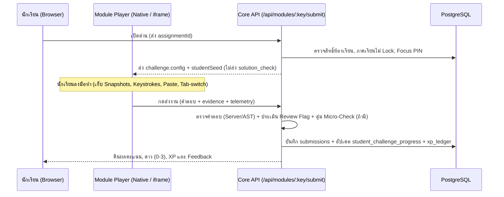

# การเลือก Tech Stack และโครงสร้างโปรเจกต์ (พร้อมขึ้นโค้ดบน Raspberry Pi 5)

เอกสารนี้สรุปชุดเทคโนโลยีที่แนะนำ โครงสร้างโฟลเดอร์ และสถาปัตยกรรมปลั๊กอินสำหรับเชื่อมกับ [DATABASE_SCHEMA.sql](file:///d:/Dev/Web-project/teaching-web/docs/DATABASE_SCHEMA.sql) เพื่อเริ่มขึ้นโครงสร้างโปรเจกต์ได้ทันที

---

## 1. Tech Stack ที่แนะนำ (Best Fit สำหรับโจทย์นี้)

ชุดนี้เน้น **"เบาบน Pi 5, พัฒนาเร็วด้วยภาษาเดียว, รองรับเกม/Interactive เต็มรูปแบบ, และไม่มีปัญหา ARM64"**

| เลเยอร์ | เทคโนโลยีที่แนะนำ | เหตุผลที่เลือก (เทียบกับข้อจำกัดของระบบ) |
| :--- | :--- | :--- |
| **Full-Stack Framework** | **Next.js (App Router, TypeScript)** | รวมทั้ง UI, SSR, API Routes ไว้ในโปรเจกต์เดียว ลดภาระการดูแลหลาย Service; รองรับ Dynamic Import สำหรับ Lazy-load แต่ละ Module |
| **Styling & UI** | **Tailwind CSS + shadcn/ui + Lucide Icons** | น้ำหนักเบา สร้าง Dashboard ครู, Heatmap, และ Game HUD ได้รวดเร็ว |
| **Database & ORM** | **PostgreSQL 16/17 + Drizzle ORM** | **Drizzle** เบากว่า Prisma มาก (ไม่มี Rust Query Engine กิน RAM บน ARM64), รองรับ `JSONB` และ Type-safety ระดับ SQL เต็มรูปแบบ |
| **Auth (Google Workspace)** | **Auth.js v5 (หรือ Arctic OIDC) + Google Provider** | เชื่อม OIDC กับ `@pccpl.ac.th` โดยตรง ตรวจ `hd === 'pccpl.ac.th'` และ `email_verified` ฝั่ง Server + จับคู่สิทธิ์จาก `staff_allowlist` |
| **Code Editor (Interactive)** | **CodeMirror 6** (`@uiw/react-codemirror`) | **เบากว่า Monaco Editor หลายเท่า** (~300 KB vs ~4 MB) โหลดไวบน Wi-Fi ห้องเรียน 25 เครื่อง และควบคุม `onPaste` / เก็บ Keystroke Telemetry ได้ง่าย |
| **In-Browser Python Runner** | **Pyodide (WebAssembly)** + Web Worker | รัน Python ของนักเรียน ม.1–ม.3 บน Browser ของนักเรียนเอง 100% และตรวจสอบโครงสร้าง AST (`ast.parse`) ได้ใน Browser/Worker ก่อนส่ง Server |
| **Block / Visual Learning** | **Google Blockly** & **React Flow (XYFlow)** | ใช้ทำบทเรียนลากบล็อก (ม.1), Flowchart และ Logic Gate Circuit Simulator (ม.2) |
| **HTML5 Game Bridge** | **iframe Sandbox + `window.postMessage` SDK** | นำเกมที่สร้างจาก Phaser / Godot Web / p5.js / Construct มาวางใน `public/games/` แล้วส่งคะแนนกลับ Core Platform ได้ทันที |
| **Web Server & Runtime** | **Nginx (Host หรือ Container) + Docker Compose (ARM64)** | Nginx เสิร์ฟ Static, Pyodide Cache และทำ Gzip/Brotli; Next.js Build แบบ `output: "standalone"` ประหยัด RAM และ Image เล็ก |

> [!TIP]
> **ทางเลือกสำรอง:** หากผู้พัฒนาถนัด **Python Backend** เป็นหลัก สามารถสลับเฉพาะส่วน API จาก Next.js API Routes เป็น **FastAPI (Python 3.12)** + **React (Vite)** ได้โดยใช้ `DATABASE_SCHEMA.sql` เดิมทั้งหมด แต่จะต้องดูแล Docker Service เพิ่มขึ้น 1 ตัวและจัดการ Type ระหว่าง Frontend/Backend แยกกัน

### เปรียบเทียบแบบเจาะลึก: Next.js + Drizzle ORM vs FastAPI + React (บนฐานข้อมูล PostgreSQL 16)

| มิติการตัดสินใจ | Next.js + Drizzle ORM + PostgreSQL 16 | FastAPI + React (Vite) + PostgreSQL 16 |
| :--- | :--- | :--- |
| **ภาษาที่ใช้** | **TypeScript ทั้งระบบ** (หน้าบ้าน + หลังบ้าน + Schema) ใช้ Type ร่วมกันได้ทันที | **2 ภาษา:** TypeScript (React) + Python (FastAPI) ต้องเชื่อม Schema/Type ผ่าน OpenAPI |
| **การพัฒนา Module ใหม่** | **เร็วกว่าและรวมศูนย์:** 1 โฟลเดอร์มีทั้ง `Player.tsx` + `grader.ts` อยู่ในโปรเจกต์เดียว | ต้องแก้ทั้งฝั่ง React (UI) และฝั่ง FastAPI (API/Grader) แยก Repo หรือ Monorepo |
| **ความเร็ว & ภาระบน Pi 5** | ใช้ Container แค่ `app` + `postgres` ประหยัด RAM และดูแล Deploy ง่ายกว่า | ใช้ Container มากขึ้น (`frontend/nginx` + `fastapi` + `postgres`) แต่ FastAPI ทำงานเบาและเร็วมากเช่นกัน |
| **การตรวจโค้ด / AST ฝั่ง Server** | ต้องตรวจ Python AST บน Browser (ผ่าน Pyodide) หรือเขียน Parser/เรียก Python subprocess | **จุดแข็งของ FastAPI:** มี Python `ast` ในตัว ใช้ตรวจ AST ของโค้ด Python ที่ส่งมา หรือทำโจทย์ Data Science/AI ฝั่ง Server ได้ธรรมชาติมาก |
| **ความสะดวกของ Auth (`@pccpl.ac.th`)** | มี **Auth.js v5** จัดการ Session Cookie, CSRF และ Google OIDC สำเร็จรูปในตัว | ต้องเขียนหรือต่อ Library OIDC (`authlib` / `httpx-oauth`) + จัดการ JWT/Cookie เองเพิ่มเล็กน้อย |
| **Learning Curve** | ถ้าไม่คุ้น React Server Components / App Router ช่วงแรกอาจสับสนจุดรัน Client vs Server | แยกชัดเจน 100% (React คือหน้าบ้านล้วน, FastAPI คือ REST API ล้วน) เข้าใจง่ายสำหรับสาย Python |

**สรุปการเลือก:**
- เลือก **Next.js + Drizzle ORM** หากต้องการ **"จบไวในโปรเจกต์เดียว ดูแลคนเดียวได้ง่าย เพิ่ม Module เกมหน้าบ้านได้คล่อง"** (ตรวจ Python/AST ผ่าน Pyodide WebWorker บน Browser)
- เลือก **FastAPI + React** หากผู้พัฒนา **"ถนัด Python มากกว่า Node.js"** หรือวางแผนจะมี Module ตรวจงาน Python / AI / Data Processing หนัก ๆ ฝั่ง Server ในอนาคต

---

## 2. โครงสร้างโฟลเดอร์โปรเจกต์ที่แนะนำ (Modular Monolith)

ออกแบบให้แยก **"ระบบแกนกลาง (`src/core`)"** ออกจาก **"โมดูลบทเรียน/เกม (`src/modules`)"** อย่างชัดเจน เพื่อรองรับการเพิ่ม Module ใหม่ในอนาคต:

```text
teaching-web/
├── docs/
│   ├── DATABASE_SCHEMA.sql          # SQL Schema สำหรับ PostgreSQL 16/17
│   └── TECH_STACK_AND_STRUCTURE.md  # เอกสารฉบับนี้
├── docker/
│   ├── Dockerfile                   # Multi-stage build (Node 22 ARM64 standalone)
│   ├── docker-compose.yml           # postgres + app (+ optional cloudflared)
│   └── nginx.conf                   # Reverse proxy + Static/Pyodide cache + Security headers
├── public/
│   ├── pyodide/                     # (Optional) Self-host ไฟล์ Pyodide ให้โหลดไวใน LAN ไม่ต้องพึ่ง CDN
│   └── games/                       # เกม HTML5/Phaser/Godot แบบ sandbox_iframe
│       └── cyber-escape-m3/         # ตัวอย่างเกมแยกไฟล์ index.html + assets
├── src/
│   ├── app/                         # Next.js App Router (Routing & Pages)
│   │   ├── (auth)/login/            # หน้า Login ด้วย Google @pccpl.ac.th
│   │   ├── (student)/               # Dashboard นักเรียน, World Map, ประวัติคะแนน
│   │   │   └── learn/[assignmentId]/# ตัวเล่น Module แบบ Dynamic Loader
│   │   ├── (teacher)/               # Class Heatmap, Code Playback, Gradebook, Export CSV
│   │   ├── (admin)/                 # จัดการปีการศึกษา, ภาคเรียน, ห้องเรียน, Import CSV, Staff Allowlist
│   │   └── api/
│   │       ├── auth/                # Google OAuth callback & session
│   │       ├── modules/[moduleKey]/submit/  # Unified Score & Telemetry Submission API
│   │       ├── teacher/             # Heatmap, Review Flags, CSV Export, Lock Semester
│   │       └── admin/               # Academic Year rollover, CSV Student Import
│   ├── core/                        # ระบบแกนกลาง (ห้ามผูกกับโค้ดเฉพาะของบทเรียนใดบทเรียนหนึ่ง)
│   │   ├── db/
│   │   │   ├── index.ts             # PostgreSQL connection pool (Drizzle)
│   │   │   └── schema.ts            # Drizzle schema ตรงกับ DATABASE_SCHEMA.sql
│   │   ├── auth/
│   │   │   ├── session.ts           # ตรวจ Session + Role (student / teacher / admin)
│   │   │   └── google.ts            # บังคับ @pccpl.ac.th & Staff allowlist mapping
│   │   ├── modules/
│   │   │   ├── contract.ts          # TypeScript Interface มาตรฐานของทุก Module
│   │   │   ├── registry.ts          # ตัวลงทะเบียน Module ทั้งหมด (Dynamic lazy-load)
│   │   │   └── iframe-bridge.ts     # ตัวกลางรับคะแนนจากเกม HTML5 ผ่าน postMessage
│   │   ├── grading/
│   │   │   ├── anti-cheat.ts        # Seed generator, Telemetry flag rules, Pin/Focus check
│   │   │   ├── xp-engine.ts         # คำนวณ XP, Stars และตรวจเงื่อนไข Badge
│   │   │   └── csv-export.ts        # ส่งออกคะแนนเรียงตามเลขที่ (รองรับภาษาไทย UTF-8 BOM)
│   │   └── components/
│   │       ├── TelemetryEditor.tsx  # CodeMirror 6 wrapper (คุม Paste + เก็บ Snapshots/Keystrokes)
│   │       └── MicroCheckModal.tsx  # Modal สุ่มถามยืนยันความเข้าใจหลังส่งโค้ด
│   └── modules/                     # โฟลเดอร์รวมบทเรียน/เกม (เพิ่มใหม่แค่สร้างโฟลเดอร์ที่นี่!)
│       ├── _template/               # แม่แบบสำหรับสร้าง Module ใหม่
│       ├── python-quest-m1/
│       │   ├── manifest.ts          # module_key, version, target_grades, metadata
│       │   ├── Player.tsx           # UI/Game ฝั่งนักเรียน (Lazy-loaded)
│       │   └── grader.ts            # กติกาตรวจคะแนน / AST / Micro-question generator
│       └── logic-gate-m2/
│           ├── manifest.ts
│           ├── Player.tsx
│           └── grader.ts
└── scripts/
    ├── backup-db.sh                 # pg_dump + rclone ไป Google Drive รายวัน
    └── seed.ts                      # สร้างข้อมูลเริ่มต้น (ปีการศึกษา, Admin, ตัวอย่าง Module)
```

---

## 3. หลักการทำงานของ Module Contract (จุดเชื่อมต่อสำหรับการขยายในอนาคต)

เพื่อให้ Module ใหม่เสียบเข้ากับระบบได้ทันทีโดยไม่แตะต้องระบบแกนกลาง ทุก Module จะต้องปฏิบัติตาม `ModuleContract` เดียวกัน:



### สัญญาข้อมูลขั้นต่ำของ 1 Module (`manifest.ts`)
1. `moduleKey`: รหัสอ้างอิงที่ไม่ซ้ำ (ตรงกับ `modules.module_key`)
2. `runtimeType`: `'native'` (React Component) หรือ `'sandbox_iframe'` (เกม HTML5)
3. `loadPlayer()`: ฟังก์ชัน `dynamic(() => import('./Player'))` เพื่อไม่ให้โหลดโค้ดของทุก Module พร้อมกันตอนเปิดเว็บ
4. `gradeSubmission(challengeConfig, solutionCheck, payload)`: ฟังก์ชันตรวจคำตอบและคืนค่า `{ score, stars, passed, feedback, reviewFlag }`

---

## 4. สถาปัตยกรรม Deployment บน Raspberry Pi 5 (แนะนำ)

- **การรันบริการ:** ใช้ `docker compose` บน Raspberry Pi OS 64-bit หรือ Ubuntu Server 24.04 ARM64:
  - Service 1: `postgres:16-alpine` (จำกัด `mem_limit: 4g`, mount volume ลง SSD M.2)
  - Service 2: `app` (Next.js standalone, `mem_limit: 4g`)
  - Web Server: **Nginx** บน Host (หรือ Container) เพื่อทำ Reverse Proxy, SSL/HTTP2 และ Cache ไฟล์ใน `public/games/` + `public/pyodide/` (ข้อดีของการ Self-host Pyodide ใน Pi 5 คือไม่ต้องพึ่งอินเทอร์เน็ตออกนอกโรงเรียนตอนโหลด Python Engine ให้เครื่อง 25 เครื่อง)
- **การเข้าถึงจากภายนอก:** ใช้ `cloudflared` (Cloudflare Tunnel) ชี้มาที่ Nginx บน Pi 5 เพื่อได้ HTTPS สำหรับ Google Workspace OAuth ทันที

---

## 5. แนวทางจำลอง Server บน Windows แทน Raspberry Pi 5 ระหว่างพัฒนา

เราสามารถจำลองสภาพแวดล้อมให้ใกล้เคียง Raspberry Pi 5 บนเครื่อง Windows ได้เกือบ 100% ก่อนนำไฟล์ `docker-compose.yml` เดียวกันไปรันบน Pi 5 จริง โดยมี 3 ระดับให้เลือกตามความเหมือนจริง:

### 5.1 วิธีที่แนะนำที่สุด: Docker Desktop (WSL 2 Backend) + Resource Limits
ติดตั้ง **Docker Desktop for Windows** (ใช้ WSL 2) แล้วรัน Stack เดียวกับบน Pi 5 (`nginx` + `app` + `postgres:16-alpine`) พร้อมจำกัดสเปกใน `docker-compose.yml` ให้เทียบเท่า Pi 5:
- **จำกัด CPU & RAM ของ Container:** ตั้ง `cpus: "4.0"` และ `mem_limit` (เช่น `postgres` 4 GB, `app` 4 GB, `nginx` 512 MB) เพื่อเช็กว่าไม่ได้เขียนโค้ดหรือ Query ที่กินทรัพยากรเกิน Pi 5 จริง
- **จำลอง Nginx Routing & Caching จริง:** ทดสอบ `nginx.conf` (Gzip/Brotli, Static Cache, `client_max_body_size`, Rate Limit) ผ่าน `http://localhost` ตั้งแต่เครื่อง Windows
- **ทดสอบสถาปัตยกรรม ARM64 (ก่อนย้ายขึ้น Pi 5):** ใช้ `docker buildx build --platform linux/arm64` บน Windows เพื่อตรวจสอบล่วงหน้าว่า Package ทุกตัวรองรับ ARM64 ไม่มี Error ตอนไป Build บน Pi 5

### 5.2 การทดสอบ Google Workspace Login (`@pccpl.ac.th`) บน Windows
- **รันบนเครื่องเดียว:** Google OAuth **อนุญาต `http://localhost:3000` (หรือ `http://localhost`)** เป็น Redirect URI ได้โดยไม่ต้องมี SSL/HTTPS จึงพัฒนาและทดสอบ Login จริงด้วยบัญชี `@pccpl.ac.th` บน Windows ได้ทันที
- **กรณีอยากให้เครื่องอื่นในวง LAN / มือถือ เข้ามาลองด้วย (HTTPS):**
  - รัน **Cloudflare Quick Tunnel** (`cloudflared tunnel --url http://localhost:80`) เพื่อรับ URL `https://....trycloudflare.com` ชั่วคราว หรือใช้ **mkcert** สร้าง Local SSL Certificate ให้ Nginx บน Windows

### 5.3 การทดสอบรับโหลด (Load Testing) บน Windows
- ใช้เครื่องมืออย่าง **k6** หรือ **Locust** ยิงทดสอบเข้า Nginx บน Windows (ที่จำกัด CPU 4 Core ไว้แล้ว) โดยจำลอง **25 concurrent users (การใช้งานจริง)** และ **150 concurrent users (Burst)** เพื่อวัด Response Time และเช็ก Connection Pool ของ PostgreSQL ก่อนนำไปใช้จริงในห้องเรียน

*(หมายเหตุ: ถ้าต้องการเขียนโค้ดแบบ Hot-Reload รวดเร็ว แนะนำให้รันเฉพาะ `postgres` + `nginx` ใน Docker และรัน `npm run dev` หรือ `uvicorn --reload` บน Windows/WSL 2 ตอนพัฒนา แล้วค่อยสลับมา Build Docker เต็มระบบตอนทดสอบก่อน Deploy)*

---

## 6. ขั้นตอนถัดไป (พร้อมเริ่มเขียนโค้ด)

หากตกลงใช้ชุด **Next.js (TypeScript) + Drizzle ORM + PostgreSQL 16 + CodeMirror 6 + Pyodide** ตามเอกสารนี้ ขั้นตอนถัดไปที่จะดำเนินการได้ทันทีคือ:
1. สร้างโครงสร้างโปรเจกต์เริ่มต้น (`package.json`, TypeScript, Tailwind, Drizzle config, `docker-compose.yml`, `nginx.conf`)
2. แปลง [DATABASE_SCHEMA.sql](file:///d:/Dev/Web-project/teaching-web/docs/DATABASE_SCHEMA.sql) เป็น Drizzle ORM Schema + Script สำหรับ Seed ปีการศึกษา/แอดมินเริ่มต้น
3. พัฒนา **Google Workspace Login (`@pccpl.ac.th`)** + ระบบสลับบทบาท (Student / Teacher / Admin) และหน้าจัดการปีการศึกษา/ภาคเรียน
4. สร้าง **Module Template + 1 ตัวอย่าง Interactive Module** พร้อม Telemetry & Class Heatmap

